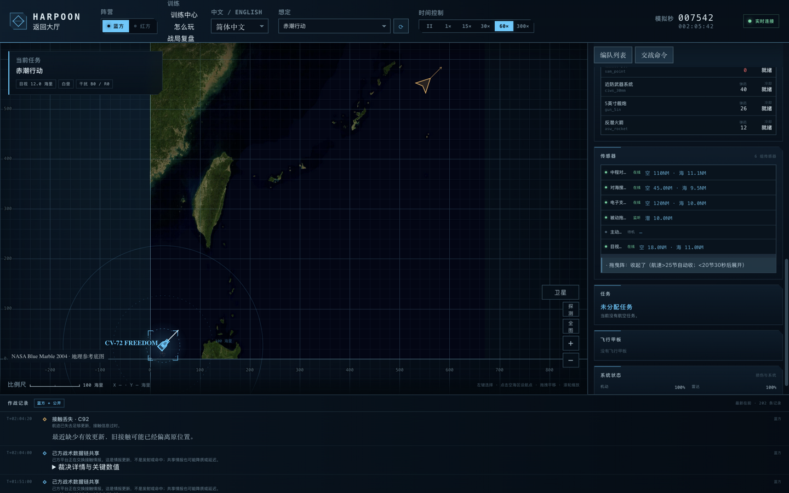
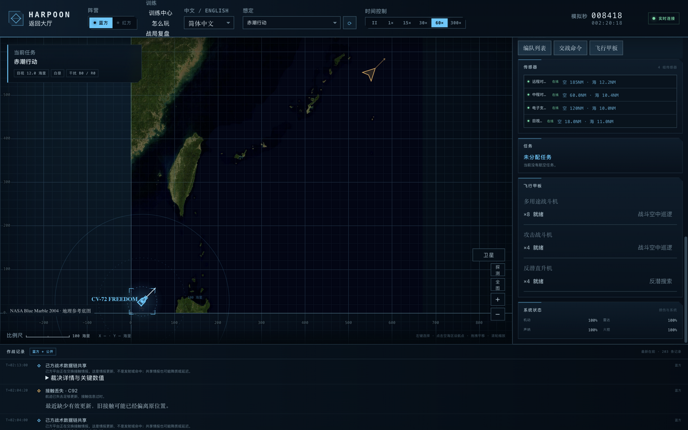
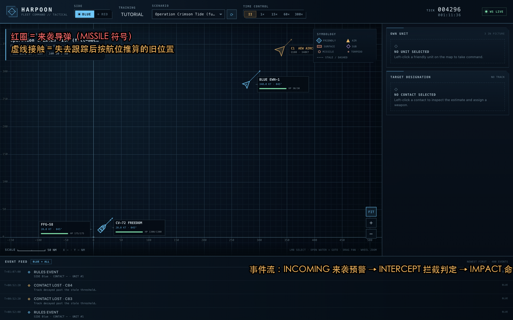

# 实战教程：反潜 / 三域打击 / 舰队防御

> 承接《[探测与编队篇](探测与编队篇.md)》。这一篇用**正在运行的想法定**当教材，
> 每章一个具体任务，从零做到完成结算。所有截图都来自真实对局。

---

## 第一章：完成一次反潜任务（赤潮行动 · 红方 SSK-7）

**任务背景**：赤潮行动里红方有一艘柴电潜艇 SSK-7 埋伏在蓝方航母编队的
航线上。它是你最大的威胁——一枚重型鱼雷 250–280 伤害，一发就能让
护卫舰沉底。

### 第 1 步：先看懂你的反潜资产

选中 FFG-58（反潜护卫舰），右侧面板的**传感器**区列出全部传感器的
**探测距离**：



逐条读：
| 传感器 | 状态 | 探测距离 | 含义 |
| --- | --- | --- | --- |
| 中程对空雷达 | 在线 | 空 110 / 海 11.1 NM | 对空主雷达；对海被地平线压到 11nm |
| 对海搜索雷达 | 在线 | 空 45 / 海 9.5 NM | 专看水面，掠海目标 |
| 电子支援侦收 | 在线 | 空 120 / 海 10 NM | 只听雷达辐射，只有方位 |
| **被动拖曳阵列** | **监听** | **潜 10 NM** | 反潜主力：拖在船尾的听音器 |
| 主动声纳 | 待机 | — | 精确但暴露，默认关闭 |
| 目视瞭望 | 在线 | 空 18 / 海 11 NM | 最后确认用 |

面板底部还有一条黄色提示：**“拖曳阵：收起了（航速>25节自动收；
<20节30秒后展开）”**——这就是手册里说的拖曳阵机制，游戏实时告诉你
它现在的状态。

**结论**：你的反潜主力是那根拖曳阵（潜 10 NM）。它在你航速低于 20 节
时自动展开；一旦你加速到 25 节以上它会自动收起（听音器拖在船尾，
高速会把它扯断）。

### 第 2 步：让拖曳阵展开

1. 选中 FFG-58
2. 在“航速”输入框填 `15`，点“下达命令”
3. 等 30 秒（60× 下约半秒）——面板提示会变成“已展开”
4. 之后**不要再让它超过 20 节**

### 第 3 步：派反潜直升机前出精查

选中航母 CV-72 FREEDOM → 滚到**飞行甲板**面板：



你会看到三行：
- 多用途战斗机 ×8 就绪 → `战斗空中巡逻`
- 攻击战斗机 ×4 就绪 → `战斗空中巡逻`（对空/打击）
- **反潜直升机 ×4 就绪 → `反潜搜索`** ← 点这个

点 `反潜搜索`：2 架直升机弹射，飞到航母位置悬停、吊放声纳听音。
直升机搜索距离短（4 NM）但它有**主动吊放声纳**——能精确定位，
而且直升机自己被潜艇发现也无所谓（潜艇的武器打不到它）。

### 第 4 步：读接触、判断是否锁定

潜艇进入你拖曳阵 10 NM 时，事件流出现：

```
T+1:12:00  发现接触 · C9 水下（被动拖曳阵列）
T+1:14:20  接触识别 · C9（识别为潜艇）
```

左侧接触列表出现 `C9 · 水下`，点它 → 目标面板显示 Q 值（质量）。
**Q ≥ 60 时才值得打**——Q 低说明只有方位没有距离，鱼雷射出去也不知道
往哪飞。

### 第 5 步：反潜攻击（两条路径）

**路径 A：直升机自主攻击（推荐新手）**
反潜直升机悬停且持有 Q>40 的潜艇接触时，**自动**在接触位置投声纳
浮标、发现目标后投轻型鱼雷（LWT，伤害 45）。你只需要保持直升机
在反潜搜索任务中，看事件流。

**路径 B：舰艇主动攻击（更快、更暴露）**
1. 选中 FFG-58
2. 点“主动声纳 → 开启”（此时你已被反潜区内所有潜艇听到，但能
   精确锁定）
3. 左键点潜艇接触 → `指派目标`
4. 武器表里选 `反潜火箭` 或（若在射程内）`轻鱼雷` → `开火`

### 第 6 步：确认战果

事件流出现 `命中 · SSK-7 · 反潜火箭 · 伤害 25` → 反复攻击直到
`击沉 · SSK-7`。**注意**：潜艇 HP 60，反潜火箭单发 25 伤害，通常
需要 2–3 轮命中。

### 反潜任务检查表

- [ ] 拖曳阵已展开（航速 <20 节）
- [ ] 反潜直升机在搜索区悬停
- [ ] 潜艇接触 Q ≥ 60 才下令攻击
- [ ] 主动声纳只在攻击窗口开，打完立刻关
- [ ] 确认击沉（`击沉` 事件），或接触持续丢失超过 15 分钟视为逃逸

---

## 第二章：三域打击——从空中、水面、水下同时出手

航母战斗群的进攻手段分三层。以打击一支敌方水面编队为例（赤潮行动
的红方导弹艇狼群）：

### 2.1 空中打击（最快、最远、最容易被拦）

1. 选中航母 → 飞行甲板 → **战斗空中巡逻** 弹 4 架战斗机（提供掩护）
2. 等接触识别为“导弹艇”且 Q ≥ 50
3. **先左键点那个接触**（重要：打击任务需要目标），再点攻击战斗机行的
   `打击` 按钮
4. 攻击机飞向目标，在 85% 反舰弹射程（约 38 NM）自主齐射后返航

**预期**：4 架攻击机 × 每架 4 枚 ASM = 16 枚掠海弹。敌方防御链
（SAM→箔条→CIWS）能拦掉大部分，但 16 枚的饱和攻击通常能漏进 2–4 枚，
足够重创导弹艇。

### 2.2 水面打击（最稳、暴露最明显）

1. 选中 DDG-101（宙斯盾，带反舰导弹）
2. 保持距离在敌舰 60 NM 内、我方舰队 40 NM 外
3. 左键点目标接触 → `指派目标`
4. 武器表选 `反舰导弹` → `开火`（一次齐射 2 发）
5. **立刻下令转向 90°**——发射闪光已经暴露了你，下一波反击马上来

### 2.3 水下打击（最隐蔽、最致命）

1. 选中红方潜艇（如果你指挥红方）或你的 SSK
2. 让潜艇以**低速（4 节）**潜航接近到目标 9 NM 内（高速会被声纳听到）
3. 左键点水面接触 → `指派目标`
4. 选 `重型鱼雷` → `开火`（一次 2 发，250+ 伤害，通常一发沉一艘护卫舰）
5. 发射后**立刻加速到 18 节转向脱离**——鱼雷发射管的声音会暴露你

### 三域协同的节奏

```
T+0   水面舰（DDG）先行齐射 → 吸引敌方防空火力、逼它撒箔条
T+10s 空中攻击机群从另一个方向进入 → 敌方注意力被引开
T+20s 潜艇补射最值钱的目标（航母/指挥舰）
```

三个方向同时来，敌方的防御链（一次只能引导 4 组 SAM）会被打穿。

---

## 第三章：舰队防御——挡住一波导弹齐射

导弹来袭是本作最紧张的 30 秒。看这张真实截图：



红色圆点就是来袭导弹（MISSILE 符号）——注意它们是从东面的红方舰队
方向飞来的。事件流同时刷出：
```
来袭警报 · C7  预计 2 秒后到达
```
每一条 INCOMING 事件都带**预计到达时间**。

### 防御按这个顺序做（总共 4 步，20 秒内完成）

**第 1 步：确认防空自动交战（不用操作）**
事件流出现 `防空拦截 · Long-Range SAM` 说明你的宙斯盾已经在打了。
防空导弹拦截率实测约 **59%**——第一道防线不需要你管。

**第 2 步：施放箔条（手动，关键）**
选中被瞄准的船 → 指挥面板 → `施放箔条`。
箔条是雷达诱饵，持续 30 秒。**导弹进入 4 NM 内有 45% 概率被诱偏**。
每次遭遇波次都撒一次，别省。

**第 3 步：转向迎敌（减小受弹面）**
导弹的末段命中判定受目标航向影响。命令舰艇把**舰艏转向来袭方向**
（航向 = 导弹来向），让受弹面积最小，同时缩短雷达反射。

**第 4 步：关掉主动声纳（如果开着）**
主动声纳会暴露你的精确位置，让敌方后续波次打得更准。

### 防御后的检查

- `拦截成功` 事件出现代表该导弹被击落
- `命中 · DDG-101 · -46 HP` 代表漏网——立刻检查系统状态面板
  （雷达/动力/火控是否损坏），损坏的船撤到后方
- `关键命中` 事件代表子系统被打坏（如动力、雷达），比掉血更麻烦

### 防御检查表

- [ ] 武器自由开启（防空系统自动交战）
- [ ] 箔条充足，每波次都手动撒
- [ ] 受瞄准的船转向来袭方向
- [ ] 主动声纳关闭
- [ ] 中弹后检查系统状态，重伤船后撤

---

## 附：完整指挥循环（背下这 8 步）

1. **看探测圈**：点“探测”，确认来袭方向没有盲区
2. **摆阵**：宙斯盾朝敌、反潜舰守尾、航母居中
3. **起飞**：CAP 巡逻掩护 + 反潜直升机搜索 + 预警机前出
4. **等接触**：定期看事件流的 DETECTION 和 IDENTIFIED
5. **判读**：Q 值够了再打，类别决定手段
6. **出手**：三域协同，交替波次
7. **防御**：来袭警报 → 箔条 → 转向 → 关声纳
8. **收尾**：看 VP 和时间，领先就拉开，落后就赌一波

---

*三章实战教程完。配合《规则教学》的基础概念与《探测与编队篇》的
原理讲解，你已经具备指挥任何想定的完整知识。*
