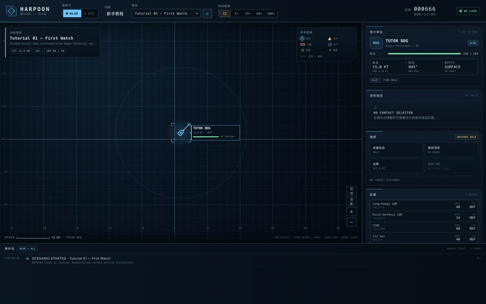
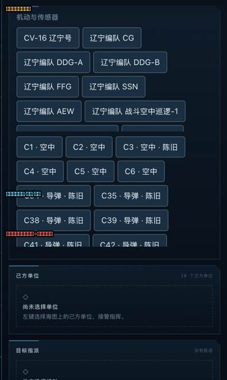

# 探测与编队篇 —— 写给完全没接触过海战的你

> 这是《[规则教学](规则教学.md)》的续篇。这一篇只回答四个问题：
> **怎么发现敌人？飞机怎么用？预警机有什么用？航母战斗群到底怎么指挥？**
> 全部用生活里的东西打比方，不需要任何军事知识。

---

## 一、探测的本质：黑屋子里找人

想象你在一个漆黑的大房间里找人。你有哪些办法？

1. **打开手电筒照** —— 你能看见他，但他也立刻看见了你。
2. **听他的脚步声** —— 你不知道他精确位置，但能猜个大概方向和远近；
   走得越重越快，听得越清楚。
3. **他打电话时偷听** —— 只有方位，没有距离。

海战里的"探测"就是这三招，一个不多一个不少：

| 生活办法 | 海战名字 | 游戏里的图标 | 特点 |
| --- | --- | --- | --- |
| 打手电筒照 | **雷达**、**目视**、**主动声纳** | 青色实线圈 | 能精确定位，**但会暴露自己** |
| 听脚步声 | **被动声纳** | 绿色虚线圈 | 隐蔽，只有大概方向 |
| 偷听电话 | **ESM 电子侦听** | 橙色方位线 | 只有方位线，误差很大 |

游戏海图上的**探测范围圈**（点"探测"按钮或选中单位显示）就是这三招的
"照明范围"：
- **青色虚线大圈** = 对空探测（雷达能看多高的飞机飞多远）
- **青色实线圈** = 对海探测（能看见多远的水面舰艇）
- **绿色虚线圈** = 对水下探测（声纳能听多深的潜艇）



*教学局中宙斯盾舰的探测圈：外面一圈是雷达能看见飞机的范围，里面一圈
是能看见水面舰艇的范围（被海平线压得很小——地球是圆的，桅杆只有
30 米高）。*

### 为什么对海圈那么小、对空圈那么大？

不是雷达不行，是**地球是圆的**。雷达波走直线，会被海面挡住。桅杆 30 米
高的雷达看水面目标，天生只有 12 海里左右；但看 8000 米高的飞机，能看
200 海里——因为飞机"高出"了海平线。**所以：想看得远，把雷达搬高。**
这就是预警机存在的全部理由（见第四节）。

---

## 二、声纳详解：水下的"听"与"喊"

雷达和目视在水下完全失效（光和电磁波进水就废了）。水下只有声波能用。

### 被动声纳 = 潜伏着听

你戴上一个超灵敏的听音器，什么都不做，就听。

- 潜艇开得越快，螺旋桨和水流噪音越大，**听得越远**。4 节慢逛的潜艇
  几乎是聋子面前的幽灵；18 节狂奔的潜艇等于在路上唱歌。
- 它也受**跃变层**影响：海水某深度有个"温度跳变层"，声波跨层传播
  会打折——目标在层下，你的探测距离减半。

**规则**：游戏里的被动声纳范围 = 基础距离 × 航速因子 × 噪声档。
拖曳声纳（隔着船尾拖一根长线听音器）收放有状态：航速超过 25 节自动
收起，低于 20 节 30 秒后自动展开。

### 主动声纳 = 喊一嗓子听回声

"主动声纳"就是朝水里**大喊一声**，听有没有回音。

- 好处：能精确定位潜艇，**潜艇在跃变层下也躲不住**。
- 代价：你这一嗓子，**方圆 1.6 倍搜索距离内的每一只潜艇都听见了**。
  规则书 §5.4 写得很清楚：ping 一下，等于向所有潜伏者广播你的位置。



*右侧指挥面板里的"主动声纳 开启/关闭"。选中护卫舰/驱逐舰后出现。
什么时候开？确认附近有潜艇、需要精确定位来反潜时才开；平时巡航
永远关着。*

**新手守则**：反潜是"先听后喊"——先用被动声纳/拖曳阵大致定位，让
反潜直升机飞过去悬停精查（吊放声纳），确认了再开主动声纳锁定、投
轻型鱼雷。一上来就开主动声纳，等于在黑屋子里喊"我来抓你了"。

---

## 三、飞机怎么安排：四种活，四种飞法

舰载机（含直升机）是航母战斗群的手和眼。游戏里每一种飞机只干一种活，
对应界面上的四个任务按钮：

| 任务按钮 | 干什么 | 用什么飞机 | 怎么判定干完 |
| --- | --- | --- | --- |
| **CAP 巡逻** | 在指定空域转圈，敌机一来就打 | 战斗机 | 敌机被击落或自己燃料到 15% 自动返航 |
| **STRIKE 打击** | 飞到目标附近，发射反舰弹/炸弹后回家 | 攻击机 | 武器全丢光，自动返航 |
| **ASW 反潜** | 飞到指定海域悬停，吊放声纳听潜艇，听到了投鱼雷 | 反潜直升机 | 燃料或任务解除 |
| **RECON 侦察** | 飞过去看一眼 | 任何飞机 | 看到即产生接触 |

### 燃料是硬约束

每架飞机有留空时间（战斗机 1.5 小时、直升机 3 小时）。燃料剩 15% 时
**自动返航**；落在甲板上要过一段时间（120–180 秒）才能再次出动。
所以：**别把所有飞机一次性全弹出去**，留一半在甲板上轮换。

### 弹射的正确姿势

选中航母 → 飞行甲板面板 → 每个机种旁边有 `巡逻`/`打击` 按钮：
- 点 `巡逻`：弹 2 架，在你点按钮时航母的位置附近建立巡逻圈
- 想打某个接触：**先左键选中那个接触**，再点 `打击` —— 打击任务需要
  一个目标接触

---

## 四、预警机有什么用：把雷达搬到天上

回看第一节：雷达看水面目标只有十几海里，因为桅杆矮。把雷达搬到
8000 米高的飞机上呢？对海探测直接变成 45–60 海里，对空 200+ 海里。

**预警机（AEW）就是一架会飞的雷达塔。** 它自己没有武器，价值全在那
个大圆盘/大鼻子里：

1. **看得远**：敌舰队、敌导弹艇在 50–60 海里外就被它标出来——你的
   全舰队共享它的眼睛（数据链）。
2. **看得久**：留空 4 小时，比战斗机的 1.5 小时长得多。
3. **代价**：它又大又慢又没武装，被战斗机咬住基本必死。

### 真实案例（赤潮行动实测战报）

```
T+00:04  预警机开机 → 立刻发现红方预警机（它也在找你）
T+18:33  蓝方预警机被红方防空火力击落
T+18:36  之后一小段时间内，对海/对岸接触全部失效
         （CONTACT LOST 连刷十几条）——眼睛瞎了，地图就瞎了
```

这就是预警机的全部意义和风险：**它是舰队的眼睛。眼睛没了，你的所有
远距离接触都会慢慢过期消失，只能等别的东西靠近重新看见。**

**使用守则**：预警机放在舰队**朝向敌人的一侧、离敌人 40–60 海里**的
位置——远到不在敌方战斗机容易偷袭的圈内，近到覆盖来袭方向。永远
派出战斗机在预警机和敌人之间做 CAP（见下节阵位图）。

---

## 五、航母战斗群指挥：标准流程

现在把所有东西拼起来。以你面前这局 **双盾行动：双航母区域拒止**
（辽宁编队 vs 福特/尼米兹编队）为例。一边一个航母战斗群，任务是
守住自己一侧的海区。

### 5.1 开局第一分钟：摆阵

航母战斗群的标准阵位（以蓝方在西、敌人在东为例）：

```
                ☁ CAP 巡逻圈（航母东北 25nm，2×战斗机）
                      ↑
                      |  敌人预期的来袭方向
                      
  [FFG 反潜护卫] —— 5nm —— [CV 航母] —— 4nm —— [DDG 宙斯盾]
       （左后方）                （中心）          （右前方）
        |                                        |
  拖曳声纳展开                             对空雷达全开
        |
  [SSK/SSN 潜艇] 前出 20–40nm，埋伏在敌来袭航线上

  [AEW 预警机] —— 朝敌方向 40–60nm，8000 米
```

一句话解释每个位置：
- **宙斯盾舰（DDG）在威胁方向一侧**：它的远程防空圈（70nm）是舰队的
  保护伞，要放在导弹必经的路上
- **反潜护卫舰（FFG）在另一侧或尾部**：拖着声纳听潜艇，别让潜艇从
  屁股后面摸进来
- **航母在中间**：它一沉游戏基本就输了
- **潜艇前出**：埋伏在敌人航母编队回家的路上，等战机
- **预警机在朝敌方向**：全舰队的眼睛（第三节）

### 5.2 开局第二分钟：把探测布置满

按"由近到远、由隐蔽到暴露"的顺序布置探测网：

1. **被动听**：护卫舰/驱逐舰的被动声纳和拖曳阵默认工作（不用管，
   保持航速低于 20 节阵就是展开的）
2. **前出看**：预警机飞向敌情预想方向；战斗机 CAP 站在预警机和自己
   之间（保护眼睛）
3. **按需喊**：只有确认潜艇就在附近、需要精确锁定时才开主动声纳

**检查方法**：点"探测"按钮显示全队探测圈。你要确认的是：敌人可能
来的方向上，你的**对空探测圈**和**对海探测圈**有没有连成一片、盖住
来袭走廊。有缺口，就往缺口派飞机或舰。

### 5.3 中盘：接触出现之后

探测到接触只是开始。按这个决策树处理每个新接触：

```
新接触出现（DETECTION 事件）
  ├─ 类别 AIR（飞机）
  │    ├─ 识别为战斗机/轰炸机 → 确认 CAP 有 fuel、武器自由开着
  │    │                        → 让 CAP 去接（敌机进 30nm 自动开火）
  │    └─ 识别为预警机 → 优先打掉！它瞎了你就安全一半
  ├─ 类别 SURFACE（水面舰）
  │    ├─ 距离 > 反舰弹射程 → 全舰队保持航向接近，等进射程
  │    └─ 距离 < 射程 → 指派目标 + 武器自由，齐射（记住：发射即暴露）
  ├─ 类别 SUBSURFACE（潜艇）
  │    → 派反潜直升机去头顶悬停精查 → 确认后投鱼雷
  │    → 潜艇高速逃窜时它会变响，抓住这个窗口
  └─ 类别 MISSILE（导弹来袭！！）
       → 自动：防空系统已经在拦截（看 INTERCEPT 事件）
       → 手动：点 DEPLOY CHAFF 施放箔条，转向让舰艏对准来袭方向
       → 每条 INCOMING 都有预计到达时间，沉住气
```

### 5.4 残局：收拾与止损

- 击沉敌舰后**别恋战**：看 VP（胜利点）和时间限制，领先就拉开距离
- 自己的船重伤（HP 黄/红）：立刻让它掉头回家，损失控制需要时间
- 飞机低燃料会自动返航，甲板占用期间不能再次弹射——看甲板面板的
  循环倒计时

---

## 六、双航母特别篇：你这局怎么打

你面前的双盾行动是双航母对双航母。两边各多了一艘航母，意味着：

1. **飞机数量翻倍**：CAP 可以两个方向轮流值班，打击可以波次进攻
2. **甲板轮换**：A 船的飞机去打，B 船的飞机在甲板待命；A 船回收时
   B 船补位——攻击波次不断
3. **两个编队分开走**：两艘航母相距 30–50nm，各带一半护航舰，拉开
   敌人的兵力；或者一个明一个暗，让敌人打错目标
4. **对手也是双航母**：敌人CAP 同样翻倍——你的打击波次会遭遇更强
   拦截，先打掉它的预警机价值巨大

**推荐节奏**（2 小时局）：
- 前 10 分钟：摆阵 + 弹 CAP + 预警机前出（时间暂停想清楚再开 60×）
- 10–40 分钟：接触陆续出现，空战先打起来；潜艇开始摸位
- 40–70 分钟：确认敌主力方向后，组织第一波打击（打击机 + 反舰弹齐射）
- 70 分钟后：收割残敌，盯紧 VP 和时间

---

## 七、探测布置自查清单

出兵前对照这张表，每一条打勾再开时间：

- [ ] 预警机在朝敌方向 40–60nm，高度 8000m+
- [ ] CAP 至少 2 架，站在预警机和敌人之间
- [ ] 全队"探测"圈打开，来袭方向没有缺口
- [ ] 反潜护卫舰的拖曳阵状态是"已展开"（航速 <20 节）
- [ ] 主动声纳全部关闭（除非正在反潜交战）
- [ ] 潜艇（如果有）已经前出到敌来袭航线
- [ ] 甲板上留有轮换飞机，没全部弹出去
- [ ] 武器自由确认开启（教程局除外）
- [ ] 时间倍速：交战时 15×–60×，行军赶路才用 300×

---

*本篇完。结合《[规则教学](规则教学.md)》第五章的手把手流程，你已经
具备指挥任意想定的基础知识。训练学院的 8 门课程（大厅 → 训练学院）
按同样思路逐课练习即可。*
