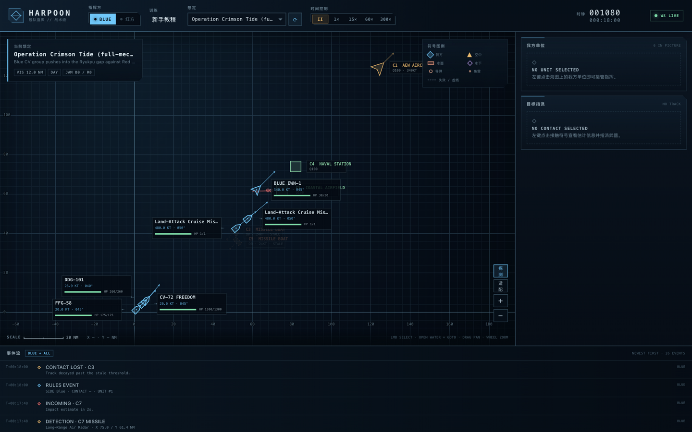
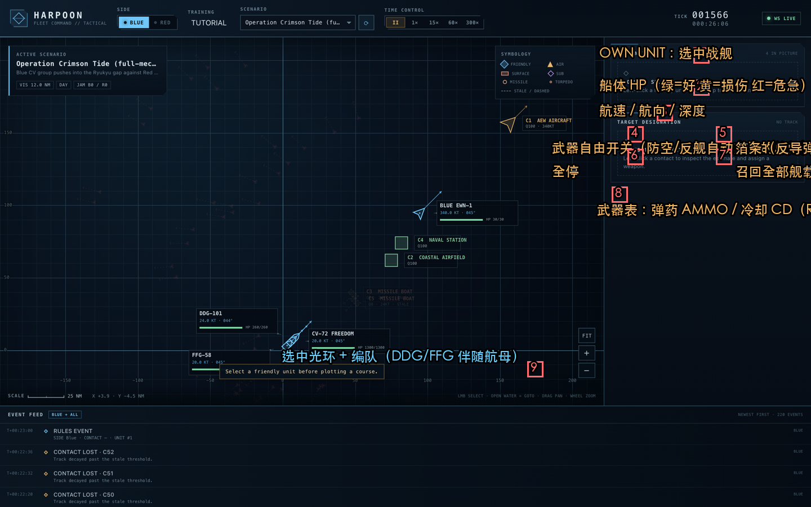
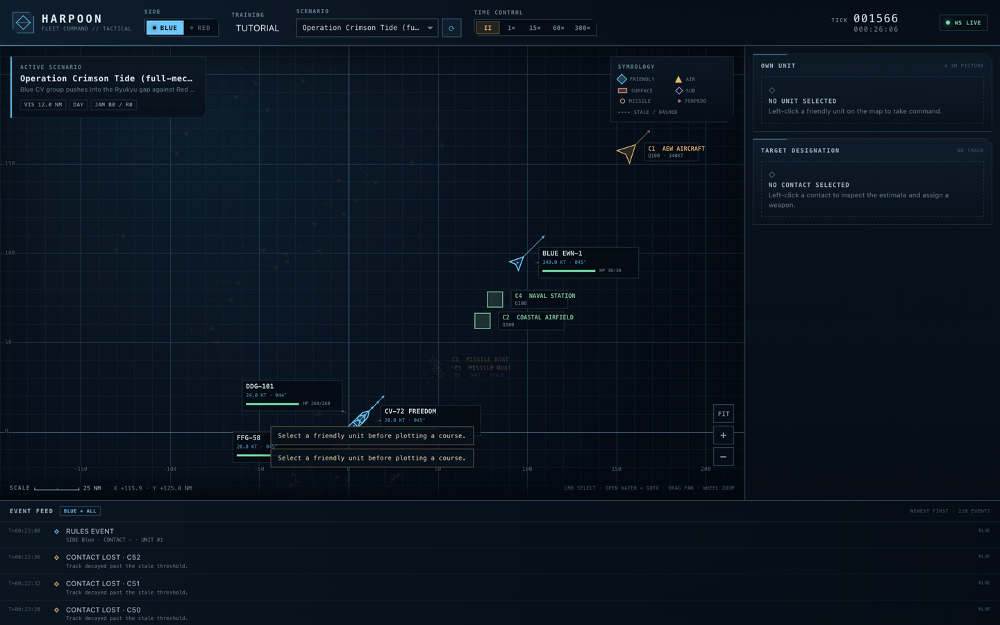
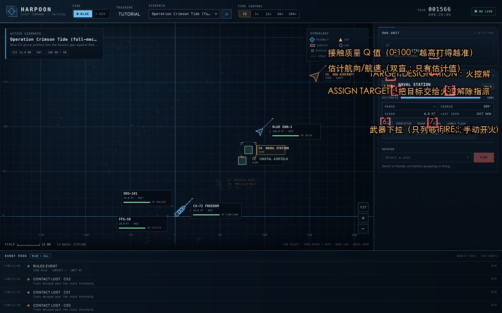

# 鱼叉 RTS 图文教学手册

> 本手册基于真实游戏截图与真实对局数据写成。所有数字（命中率、事件时间线）
> 都来自引擎实测（`examples/intercept_probe.rs`、`examples/crimson_tide.rs`），
> 不是宣传语。读完这一篇，你就能独立指挥一场舰队战役。

---

## 目录

1. [这是什么游戏（60 秒版）](#1-这是什么游戏60-秒版)
2. [开局三步](#2-开局三步)
3. [界面导览](#3-界面导览)
4. [五个核心概念](#4-五个核心概念)
5. [手把手第一局：炮术对决（十二步）](#5-手把手第一局炮术对决十二步)
6. [案例战报：赤潮行动时间线](#6-案例战报赤潮行动时间线)
7. [武器与防御体系速查](#7-武器与防御体系速查)
8. [RTS 改编对照表：桌面规则怎么变成了电子规则](#8-rts-改编对照表)
9. [常见疑问（为什么看不到敌人 / 打不中 / 接触消失）](#9-常见疑问)
9b. [续篇：探测与编队篇（零基础声纳科普 / 预警机 / 航母编队指挥）](探测与编队篇.md)
9c. [实战教程：反潜 / 三域打击 / 舰队防御（配真实截图）](实战教程.md)
9d. [双航母击杀赛详细战报（六小时全量战报 + 实况截图 + 状态机架构说明）](aar/双航母击杀赛战报.md)
10. [进阶：数据卷 / AI 参谋 / API](#10-进阶)
11. [附录：指令与事件速查](#11-附录速查)

---

## 1. 这是什么游戏（60 秒版）

经典桌面兵棋《Harpoon》（鱼叉）的**实时战略（RTS）电子化版本**。

桌面原版： hex 格子、3 分钟一回合、掷 D100 查表、需要一个真人裁判替双方
秘密记录敌情（"双盲裁判"）。

本作把这三样全部电子化：

| 桌面版 | 本作 |
| --- | --- |
| 回合制（3 分钟/回合） | **连续时间轴**：1 秒一个模拟步，随时暂停/加速（最高 300×） |
| D100 查表裁决 | **确定性引擎掷点**：同一存档重放结果完全一致 |
| 人工双盲裁判 | **服务器即裁判**：你看不到敌人真身，只有"接触"（估计位置） |

你扮演一方舰队指挥官。核心循环只有五步：

```
机动（下令航向） → 探测（传感器找目标） → 指派（把接触交给火控）
→ 开火（武器自动/手动射击） → 防御（箔条/防空拦截来袭导弹）
```

内置想定：
- **Tutorial 01**（新手教学，界面左上 TUTORIAL 按钮可进入引导模式）
- **Gunnery Dual**（1 艘宙斯盾舰 vs 2 导弹艇，10 分钟教学局）
- **Crimson Tide**（航母战斗群全要素战役，18+ 机制）
- **Pacific Storm**（大型联合战役）
- **Tattletail**（官方经典想定复刻，北约反潜警戒群 vs 苏联潜艇）

---

## 2. 开局三步

1. 启动：`cargo run --release -p harpoon-server`，浏览器开 `http://localhost:8787`
2. 顶栏 **SCENARIO** 下拉选想定 → 点右侧 **⟳** 开局（下图 3 号位）
3. 点 **TIME CONTROL** 里的 **60×** —— 时间开始流动，事件流开始报点



上图编号：①指挥侧别 ②TUTORIAL 教程入口 ③想定选择+开局 ④时间控制
⑤模拟时钟 ⑥实时数据链状态 ⑦想定简报/气象 ⑧符号图例 ⑨缩放/适配
⑩事件流。**下方大海图就是战场**：蓝色符号是你的兵力，橙色三角是敌机
接触，绿色方块是敌岸上基地，虚线符号是失效的旧接触。

---

## 3. 界面导览

### 3.1 选中自己的船

**左键点击海图上的蓝色符号**。右侧展开三块面板：



- **OWN UNIT**：船体 HP 条、航速/航向/深度
- **COMMAND**：
  - `WEAPONS FREE`（武器自由）——总闸。开着时，火控系统会**自动**向
    有火控解的目标开火；新手建议保持开启
  - `DEPLOY CHAFF`（箔条）——来袭导弹的诱饵，每次施放持续 30 秒
  - `ALL STOP` 全停 / `RECOVER AIR` 召回舰载机
- **WEAPONS 表**：每座武器的 `AMMO`（弹药）与 `CD`（冷却，RDY=可用）
- 航母/机场会多一块 **FLIGHT DECK**（飞行甲板）面板：联队就绪数 +
  每个机种的 `CAP / STRIKE / ASW` 弹射按钮

### 3.2 下令机动

保持选中状态，**左键点击海图开阔海域** = 追加一个航路点（Waypoint），
战舰会以限定转向率转向过去。可以连续点多个点排成航线。



顶部提示 `WAYPOINT 1 QUEUED · X 48.0 / Y 40.1 NM` 说明指令已被服务器接受。
指令在**下一个模拟秒**生效——如果游戏是暂停的，恢复时间后才会动。

### 3.3 指派目标与开火

**左键点击橙/红色的接触符号**，右侧 TARGET DESIGNATION 面板展开：



- **Q 值（质量）**：火控解 0–100。规则：手操开火需要 Q≥30；Q 越高命中
  越稳。质量随跟踪时间上升、目标丢失视界后衰减
- **ASSIGN TARGET**：把目标交给火控，武器会自动按包线开火
- **武器下拉 + FIRE**：手动指定某一座武器打一轮

---

## 4. 五个核心概念

### 4.1 双盲与"接触"——你永远看不到敌人的真身

引擎内部知道每艘船的真位置，但**只给你看"接触"（Contact）**：一个带
误差的估计位置。每个接触有：

- **类别**：AIR / SURFACE / SUBSURFACE / MISSILE / TORPEDO（探测方式决定，
  见 4.4）
- **质量 Q**（0–1 显示为 Q00–Q100）：跟踪越久越高；丢失视界后每 4 秒
  衰减 10%，归零即 **STALE（失效）**——符号变虚线，位置按最后航向航速
  航位推算，**不能用来开火**（除非走 BOL 定方位发射，Pk×0.25）
- **识别**：跟踪质量到 0.7 或距离足够近时，`CONTACT IDENTIFIED` 事件会
  告诉你它是"Missile Boat"还是"Coastal Airfield"

实战含义：**丢失 AEW 预警机 = 丢掉半张地图**。上图里 C5/C3 两个失效的
导弹艇接触就是预警机被击落后留下的旧位置。

### 4.2 探测：五种传感器各有地盘

| 传感器 | 能看什么 | 关键限制 |
| --- | --- | --- |
| 雷达（对空/对海/导航） | 空/海/导弹 | **雷达地平**封顶（30m 桅杆对海≈12nm）；对掠海弹只有 ~18nm 反应时间 |
| ESM 侦收 | 敌人的雷达辐射 | 只有方位没有距离（误差 22nm），但极远 |
| 目视 | 水面/岸 | 受气象/昼夜限制（夜晚 ×0.5） |
| 被动声纳 | 潜艇/水面噪声 | 航速越快越响；潜艇深潜跨跃变层 ×0.5 |
| 主动声纳 | 潜艇 | 精确但**开机即暴露**——1.6 倍距离内敌方被动声纳全都听得见你 |

另外：**发射即暴露**。你发射反舰导弹的瞬间，附近敌人会得到一个"发射
闪光"接触——齐射有代价。

### 4.3 时间倍速与指令

服务器按 1 秒一步推进模拟，你调的是**回放速度**：0×（暂停）到 300×。
指令（航向/开火/弹射）提交后**下一个模拟秒生效一次**，此后作为状态保持
（航线会一直飞）。**暂停时提交的指令要等恢复时间才生效**——新手最常见
的困惑就是"点了没反应"，先看是不是暂停着。

### 4.4 拦截链：反舰导弹攻防的完整流程

这是本作最核心的对抗。以一次导弹艇齐射打宙斯盾舰为例（实测数据）：

```
MGB 齐射 4×YJ-83（射程 60nm，掠海 8m，末段 560kt）
   ↓ 发射瞬间：DDG 得到"发射闪光"接触（立刻知道大概谁打的）
导弹飞行 8nm 进入 DDG 雷达地平 → INCOMING 事件（含预计到达时间）
   ↓ DDG 火控自动接战：sam_long 齐射 2 发（指挥仪同时最多引导 4×2 发）
SAM 命中判定 Pk 0.55（命中即击落来袭弹）
   ↓ 没拦住？导弹继续飞。8nm 时守方自动撒箔条（雷达被诱骗 45%）
   ↓ 1.8nm 时 CIWS 近防炮最后一道（Pk 0.30/波）
   ↓ 末段判定：Pk 0.55（箔条窗口内 ×0.45）
命中 → 伤害 42±15% + 关键命中掷点（动力/雷达/进水/火灾/弹药库殉爆…）
```

实测（10 个种子各 90 分钟）：**321 发 SAM → 59% 拦截成功率**，漏网弹
最终只有极少数命中。防空是可信的，但别拿巡洋舰硬抗齐射——先撒箔条、
再转向把船艏对准来袭方向（缩小受弹面）。

### 4.5 空空作战

战斗机 CAP（战斗空中巡逻）会自动接敌：雷达锁定（对空探测距离
110nm，不再被目标尺寸缩水）→ 30nm 发雷达制导中距弹（Pk 0.55）→
15nm 内红外弹收尾（Pk 0.50，末段可被剧烈机动甩掉 25%）→ 6nm 内进入
**狗斗**（每 15 秒一轮航炮互殴）。对方的激烈机动会显著降低你的命中。

---

## 5. 手把手第一局：炮术对决（十二步）

用 **Gunnery Dual**（宙斯盾舰 vs 两艘导弹艇）走完整流程：

| 步 | 操作 | 你会看到 |
| --- | --- | --- |
| 1 | 选 BLUE，开局，60× | 事件流：SCENARIO STARTED |
| 2 | 点你的 DDG 符号 | 右侧面板展开，确认 WEAPONS FREE 是 ACTIVE |
| 3 | 点舰艏前方海图（敌在东南方） | WAYPOINT QUEUED，船开始转向 |
| 4 | 等 ~40 分钟游戏时间（2400s） | 事件流 DETECTION · C1 SURFACE |
| 5 | 等到 CONTACT IDENTIFIED · Missile Boat | 识别完成 |
| 6 | 左键点接触符号 | 目标面板出现，Q 值随时间上涨 |
| 7 | 点 ASSIGN TARGET | NO TARGET ASSIGNED 变成目标名 |
| 8 | 拉近到 11nm 内（舰炮射程） | 火控自动开炮：GUN ACTION 事件 |
| 9 | 敌艇进 60nm 后会还射导弹 | INCOMING 事件 + 自动 SAM 拦截 |
| 10 | 看到多个 INCOMING 时点 DEPLOY CHAFF | CHAFF DEPLOYED 事件 |
| 11 | 持续交战至敌沉 | CONTACT SANK / IMPACT / SUNK |
| 12 | 时间耗尽或全歼 | SCENARIO ENDED 覆盖层 + VP 判定 |

> **新手最常翻车点**：
> 1. 指令没反应 → 游戏在暂停
> 2. 看不到敌人 → 雷达地平外，需要 AEW/前出兵力
> 3. 打不出炮 → 没有火控解（Q 太低）或超出射程；先 ASSIGN 再等
> 4. 被导弹打爆 → 没保持 WEAPONS FREE 或忘撒箔条

---

## 6. 案例战报：赤潮行动时间线

下面是 **Crimson Tide** 一局的真实事件序列（驱动器实录，非编造），
教你读战报：

| 游戏时间 | 事件 | 解读 |
| --- | --- | --- |
| T+00:04 | DETECTION · C1 AIR（长程对空雷达） | 双方预警机先看见彼此——空战 always 先行 |
| T+04:51 | WEAPONS RELEASE · DDG-101，Land-Attack ×1 | 宙斯盾向已识别的岸上目标自动齐射对地巡航弹 |
| T+09:13 | WEAPONS RELEASE · DDG-101 ×1 | 第二发 SLCM；**注意**：发射闪光让红方反定位（COUNTER-DETECTED） |
| T+18:12 | IMPACT · BLUE EWN-1（Point-Defense SAM，28.5 伤害） | 蓝方预警机被红方点防空击伤——**深入敌防空圈有代价** |
| T+18:33 | AIRCRAFT DOWN · BLUE EWN-1 | 预警机坠毁。之后对海/对岸接触陆续失效（CONTACT LOST 一串） |
| T+55:53 | WEAPONS RELEASE · RED MGB-1，ASCM ×2 | 导弹艇狼群借 ESM 找到航母编队，60nm 外齐射 |
| T+55:56 | INCOMING · C6 | 来袭预警：预计 1 秒后到达判定点 |
| T+59:18 | INTERCEPT SUCCESS（Long-Range SAM） | 区域防空拦下第一波 |
| T+76:16 | IMPACT · DDG-101，-46 HP | 有漏网弹命中宙斯盾舰 |
| T+12:48 | DETECTION · C9 SUBSURFACE（拖曳阵） | 潜艇高速机动后暴露在拖曳声纳下 |
| T+22:08 | TORPEDO DETECTED / DECOY FOOLED | SSK 齐射重型鱼雷，航母箔条成功诱偏 |
| T+4:33:10 | GUN ACTION · FFG-58，1 hit | 近距炮战，导弹艇被 5in 舰炮击沉 |
| T+4:33:58 | CONTACT SANK · C68 | 首个击沉判定 |
| … | STRIKE / SLCM 对岸、跑道降级 | 对岸打击降低敌机场出动率 |
| 结束 | SCENARIO ENDED · 胜负 + VP | 按击沉/毁伤累计胜利点 |

**读战报的诀窍**：每条事件都有归属（BLUE/RED/ALL）。你只会看到自己
一侧+公共事件——看到一串 CONTACT LOST 时，先想想是哪个传感器平台
没了，而不是"游戏卡了"。

---

## 7. 武器与防御体系速查

### 7.1 武器类型（kind → 行为）

| 类型 | 打击对象 | 行为 |
| --- | --- | --- |
| Gun（舰炮） | 水面/岸/低空飞机 | 即时裁决；**射界带**：舷侧 100% / 斜向 73% / 艏艉 33%，近距离带基准 75%→15% |
| Ciws（近防炮） | 来袭导弹/飞机 | 只在导弹防御链里自动开火（1.8nm） |
| Sam / Aam | 飞机/来袭导弹 | 发射制导弹；指挥仪通道限制同时接战数 |
| Ascm（反舰巡航弹） | 舰/岸 | 掠海 8m 飞行，可被箔条/CIWS 拦 |
| Slcm（对地巡航弹） | **仅岸上目标** | 同上，长射程 |
| Torpedo（鱼雷） | 舰/潜 | 直航到归黄点→±60°锥角搜索→追踪；可被诱饵骗（55%→三代弹仅 25%） |
| Lwt（轻型鱼雷） | 潜艇 | 直升机/反潜专用的短程版 |
| AswRocket（反潜火箭） | 潜艇 | 抛射到预定点裁决 |
| Bomb / Rocket（炸弹/火箭） | 舰/岸 | 非制导，需 <900m 低空进入（§9.6） |

### 7.2 通用数值口径

- **Pk**：单发命中概率（末段判定）。全库 407 平台/264 武器都能在
  `GET /api/db` 里查
- **伤害**：命中后扣 HP；HP 是官方伤害点数（DP）量级（航母 1300+，
  导弹艇 45）
- **关键命中**：血量越低越容易触发——动力/雷达/声纳/火控/炮位/进水/
  火灾/弹药库殉爆；水下列以**进水**为主（每秒持续掉血）
- **损管**：火灾 60 秒/进水 120 秒可扑灭，系统受损 300 秒后逐步修复；
  再次中弹打断抢修

---

## 8. RTS 改编对照表

桌面 Harpoon 的规则在电子化时做了系统性改编，全部逐条登记在
[`docs/design/adaptations.md`](../design/adaptations.md)。最重要的十几条：

| # | 桌面规则 | 引擎做法 | 为什么 |
| --- | --- | --- | --- |
| 1 | 3 分钟回合 + 30 秒增量 | 1 秒 tick 连续时间，0–300× 倍速 | RTS 核心 |
| 2 | D100 查表裁决 | 标量 Pk + 确定性掷点（xoshiro256**） | 可复现、可回放、可做 AI 训练 |
| 3 | 雷达视距查表 | 闭式公式 `1.23×(√h₁+√h₂)` 海里 | 对官方表逐格回归验证，误差 <0.3nm |
| 4 | 双盲靠人工登记 | 服务器接触簿 + 持久误差向量 | 裁判即服务 |
| 5 | 探测按"签名×雷达代次"查表 | 传感器距离 × RCS 档位 × 天气/干扰 | 数据驱动；对空距离不再乘舰体 RCS（实测修正） |
| 6 | 导弹攻防查"三秒规则"表 | SAM 包线→箔条→CIWS→末段 Pk 链 + 拦截碎片空爆 | 层次一致，时间连续化；实测 59% 拦截率 |
| 7 | 舰炮 D100 射界带 75/55/25/15% | 距离带基准 × 方位乘数（舷侧/斜向/艏艉） | 同一分布的乘法近似 |
| 8 | 鱼雷归黄 + 每回合搜索 | 归黄点→±60°锥角→追踪→诱饵 55%/25% | 搜索几何简化 |
| 9 | 关键命中表 | 双列（水面/水下）子系统表：进水/火灾/桥楼/舵机/CIC… | 结构对齐扩展损伤手册 |
| 10 | 航空调度表 | 甲板周期 + CAP/打击/反潜/侦察任务 | 无中队聚合（单机实体） |
| 11 | 指令阶段锁定 | 任意时刻下令，下一秒生效，指令日志即复盘 | RTS 实时性 |

**设计立场**：凡是改编都有登记；凡是没改的（雷达地平、射界带比例、
声纳航速-噪声关系、导引头代次……）都按规则书实现并带页码出处。
四轮独立规则审计报告在 `docs/compliance/`。

---

## 9. 常见疑问

**Q：我下达了航向但船不动？**
A：游戏在暂停。恢复时间（点任意速度按钮）。暂停期间指令已排队。

**Q：明明附近有敌人，为什么我看不到？**
A：双盲。你只能看到传感器够得着的敌人。对海雷达被**雷达地平**限死
（桅杆高度决定），掠海的导弹艇可能 10nm 内才现身——这就是为什么需要
预警机前出（雷达高度=视距）。

**Q：接触符号变虚线了？**
A：跟踪丢失（质量衰减到 0），符号按最后航向航速漂移。重新照亮它的
办法：派飞机/军舰过去，或者等它自己开雷达。

**Q：空空导弹/防空导弹打不中？**
A：修复后实测：防空拦截 59%，空空末段命中 ~47%。如果你看到的比这低
很多：(1) 目标有没有箔条/剧烈机动（各自 ×0.85 / ×0.75）；(2) 是不是
多枚导弹打同一目标（3 发以上在途每发 ×0.7 饱和惩罚）；(3) 火控解质量
够不够。都正常还打不中，那就是运气——规则书的分布就是这样，继续射，
或者换更大齐射。

**Q：潜艇为什么神出鬼没？**
A：被动声纳靠噪声：潜艇以 4 节潜航时几乎聋子面前的幽灵（噪声档 24，
航速因子 0.3）。它一开高速（18 节）噪音暴增 7 倍立刻暴露——**潜艇的
博弈就是"什么时候快"**。跃变层之下再打五折。

**Q：事件流一直滚 CONTACT LOST？**
A：正常。接触质量衰减就报丢失，导弹被拦截后它的接触也会失效。关注
DETECTION / IDENTIFIED / INCOMING / SUNK 这几类关键事件即可。

**Q：怎么用 407 艘真军舰？**
A：想定 JSON 里 `"class": "cn_052d"`、`"us_burke_3"`、`"ru_kirov"`、
`"uk_type45"`……全部 407 类在 `GET /api/db` 可查，
`database/volumes/*.provenance.md` 有每类的卷页出处。

---

## 10. 进阶

- **AI 参谋**：设 `HARPOON_LLM_BASE_URL`/`HARPOON_LLM_API_KEY`/
  `HARPOON_LLM_MODEL` 后，`POST /api/ai/step/Blue` 让大模型替你指挥；
  未配置时内置启发式参谋（自动接敌教义）
- **API 速查**：`GET /api/state?side=Blue`（双盲态势）、
  `POST /api/command`（下指令）、`POST /api/time`（倍速）、
  `POST /api/selfplay`（AI 自对弈）
- **MCP**：`cargo run -p harpoon-mcp` 即把引擎接给支持 MCP 的大模型客户端
- **RL 训练**：`crates/harpoon-py` 提供 Gym 环境；
  `crates/harpoon-server --example pacific_smoke` 是确定性回归样板
- **想定创作**：仿写 `scenarios/crimson_tide.json`——纯 JSON，407 类
  军舰任意组合

---

## 11. 附录速查

### 指令 JSON（POST /api/command，`{"side":"Blue","command":{...}}`）

```jsonc
{"cmd":"set_speed","unit":1,"speed_kts":25}
{"cmd":"goto","unit":1,"waypoints":[[100,50]]}
{"cmd":"assign_target","unit":1,"contact":3}
{"cmd":"fire","unit":1,"contact":3,"weapon":"gun_5in","rounds":1}
{"cmd":"deploy_chaff","unit":1}
{"cmd":"launch_aircraft","unit":1,"class":"fighter","count":2,
 "mission":{"mission":"cap","station":[44,44],"radius_nm":18}}
{"cmd":"set_weapons_free","unit":1,"free":true}
```

### 关键事件（事件流里最值得盯的）

`DETECTION`（新接触）· `INCOMING`（来袭！含 ETA）· `INTERCEPT`（拦截
成败）· `IMPACT`（中弹+掉血）· `CRITICAL HIT`（关键命中：哪个子系统坏
了）· `SUNK`（击沉）· `AIR LAUNCH`（舰载机出动）· `SCENARIO ENDED`（终局）

---

*手册完 · 截图与数据均取自真实对局 · 规则出处见
`docs/design/adaptations.md` 与 `docs/compliance/rules-coverage-matrix.md`*
