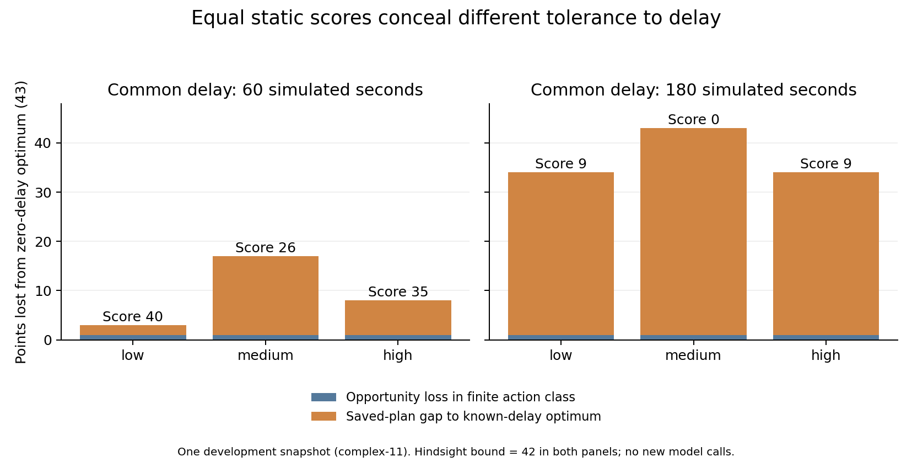

# 实验复核与科研方向调整：从静态答对到及时生效

2026-10-22。已复核 M1b、M2a、M2b/M3a 报告与关键冻结汇总，并作独立设计审查。**方向值得继续；当前最有价值的线索是时效性如何改变决策评价，而非已证明高推理档或模型自写条件更强。** 本轮新增的是旧数据再分析和下一阶段设计，没有发起新模型请求或新环境轨迹。

## 目前有什么有趣发现

### 1. 同样“答对”，行动价值可以差很多

M3a 的 complex-11 三份计划在零延迟下均得43分。给予同样60模拟秒等待后，low/medium/high计划分别40/26/35；知道该延迟的有限动作类最优仍有42分。由此可以把总损失作诊断分解：

| 共同延迟60秒 | low | medium | high |
| --- | ---: | ---: | ---: |
| 零延迟分数 | 43 | 43 | 43 |
| 延迟后实际分数 | 40 | 26 | 35 |
| 该有限动作类的机会损失：43−42 | 1 | 1 | 1 |
| 所选计划相对同延迟前沿的差距 | 2 | 16 | 7 |

180秒等待时前沿仍为42，三份计划9/0/9，差距33/42/33。**这个例子的大部分分差体现为所选计划相对同延迟事后最优前沿的差距；等待并未使所有方案都失去高分机会。** 三档选择了不同的分工和任务顺序，静态评分没有区分这些最优解的余量。

这是一个事后选取的开发样例；完整再分析保存全部17有效计划×3延迟，共51行。分解是算术恒等式，前沿使用确切延迟，是事后上界；不能据此声称在线知道等待长度就免费获得42分，也不能称“推理档导致了相应损失”。应在未见任务中检验同分方案的时间鲁棒性是否普遍被忽略。

### 2. 更早唤醒，可能更晚获得可用的新方案

M2a中，立即事件调用可能遇到第二次更新：等到旧回复返回并拒收后才重算。稍晚唤醒反而一次读到最新状态。M2b统一初态、固定几何和100秒脚本响应后，等任务安静30秒的Q30在16格逐格保持EH的完成结果（12/16），在线请求32→24，减少25%。

但原任务只计最后仍有效目标；旧通知可以被覆盖，合并天然容易获益。因此新实验增加“新任务追加，旧任务仍有累计价值”的配对。我们要检验的是**等待获得更多信息的收益，何时会被错过行动机会的损失超过**。目前还不是“事件触发一定优于固定周期”或“统一等待30秒最好”。

### 3. “模型自写条件有效”容易被初始化收益混淆

M2a的20份模型条件都等同于人工的任务不匹配条件；关闭初始化之后的条件执行，8局完成数3→1，说明部分成功依赖条件，但另有成功仅靠初始化恢复。M2b使用同条件、同就绪状态后，EH/EM的16格World与调用数全部一致；冷启动EM完成9/16，就绪后12/16。

这个发现支持严格区分**规则生成、规则执行、初始化/恢复**三部分。下一批需要多种有真实判断价值的可见特征和安装后的触发机会，再谈模型是否写出了更好的条件。当前没有自写规则优于人工规则的证据。

### 4. “约束更多”不等于“需要更多LLM推理”

M1b的12份有效回复、M3a的17份有效回复都达到各自零延迟有限最优。M3a资源限制不是装饰：九任务最优均43，放宽共享资源后complex-11/23/37分别升至70/68/70，去掉前置关系均变52。本轮按原始汇总纠正了旧报告概括成70的文字误差，原始数据未改。但当前小规模问题仍被low解到最优，公开抗延迟规划器计实际CPU耗时后六例也都达最优，约0.12–1.04秒。

这界定了当前任务的适用范围。应保留传统规划器为强对照，并明确LLM承担的高层判断；继续堆任务数来追求high获胜，可能只变成数值优化题，偏离联合调度。M3a唯一无回复请求是SSE空闲超时，用量未知；它不是一道规划错题，也不足以证明high更不可靠。

## 项目应怎样定位

鱼叉平台目前最大的研究价值是：**世界可以在思考期间继续演化；合法观察和裁判状态可以分开；同一份计划能重新执行，以检查何时失效。** 这使“回答质量”与“生效后的行动价值”可以被分开测量。复杂舰队和交战可成为后续验证环境；当前M3a仍是每舰独立导航World加联合任务账，尚无完整舰队相互作用、通用军事指挥或机器人迁移证据。

主问题维持为：在变化的信息、行动截止和有限计算预算下，**何时重新决策、思考多少，才能提高实际累计收益？** 下一阶段把可见信息变化、旧计划继续执行、不可撤销资源投入放进同一个小型持续任务，而不是先扩大战场规模。

计划原来要求“先出现高预算内容收益”，这一门槛过窄，已经修正为“验证计算净收益是否依赖可观察状态”。允许某些状态始终low更好；也允许整个当前任务域固定low已足够。若仅唤醒有收益而预算档位无可利用差异，论文应据实收窄，不能仍宣称联合预算算法有效。

## 下一批实验

完整操作定义见 [M3b开发协议](../research/realtime/m3b-protocol.md)。按下列顺序推进，先做便宜、可解释的实验。

| 顺序 | 实验 | 要排除的解释 |
| --- | --- | --- |
| 1 | 覆盖/追加任务×密/疏事件×紧/宽余量×四相位；256脚本主轨迹，另48条响应时长控制 | Q30是否只利用旧任务不计分；等待与服务时延是否混淆 |
| 2 | 三种小型任务结构，逐步公开证据，作业开始后消耗资源，旧计划持续运动 | 复杂度是否只有表面约束；隐藏未来是否变成无依据猜谜 |
| 3 | 12个预先规定的公开快照×三档×两次请求，最多72次探索调用 | 预算是否改变内容或延迟下的价值；偶然输出与服务波动有多大 |
| 4 | 通过任务和差异审查后，做持续闭环与联合选择 | 固定快照的优势能否持续；收益是否只是花了更多费用 |

三种任务结构是前置调查链、互斥后续机会、多个单位争用共享资源。先验与证据可靠性公开，未来事件样本不公开；共享执行器处理导航可行性，模型选择任务/资源意图。保留同信息的信念更新和滚动规划基线。72次是先导额度，不是正式功效充分的样本量；先导后按独立实例方差和最小关注效应冻结确认规模。

联合阶段比较最佳固定频率×固定档、强事件/混合、只调唤醒、只调预算、分别调优后组合和联合调优；所有初始化、恢复、调度与执行计算计账。继续保留失败和零收益单元，不按哪个方法获胜筛剧本。

## 朝CCF A推进还缺什么

我们已有可信的开发平台和若干机制线索，尚未形成完整论文贡献。最值得争取的是：证明静态质量与实时有效性之间存在可推广的测量偏差，并据此构造一个能预测“现在值不值得算”的联合策略，在强基线和留出任务上验证。

本轮复核了四篇原始论文的摘要/版本入口，已有工作分别覆盖实时反应与深思结合（[AgileThinker，2025-11-07](https://arxiv.org/abs/2511.04898)）、多轮预算分配（[TAB，v3 2026-08-08](https://arxiv.org/abs/2604.05164v3)）、持续/暂停/Token时钟及推理强度（[Realtime-Bench，v2 2026-10-18](https://arxiv.org/abs/2610.22155v2)）、依据历史生成触发条件（[ChronosBench，2026-01-14](https://arxiv.org/abs/2601.09382)）。因此“思考越久可能迟到”“预算自适应”“模型自己写条件”本身不足以作为首创。该核对不是系统综述或全文排重；是否已有相同贡献仍需M0继续验证。

候选贡献取决于后续证据，可落在联合方法，也可落在可信评测与重要行为发现。机器人等前景说明问题的潜在应用范围，不能替代迁移实验或支撑录用保证。

## 本轮证据与复核范围

- 来源：[M1b](research-realtime-m1b-20261021.md)、[M2a](research-realtime-m2a-20261022.md)、[M2b/M3a](research-realtime-m3a-20261022.md)及其冻结证据。旧报告中的“下一步/门槛”是历史决策，本轮以根计划和M3b协议为准。
- 派生数据：[evidence-review.json](../research/realtime/review-20261022-v2/evidence-review.json)。读取的5份M3a汇总全部与原manifest的字节数/SHA256一致；本轮没有重新核验全部1720文件，也未重跑旧轨迹。
- 复算入口：`python scripts/review-realtime-evidence.py --stage E:/CodexBuilds/harpoon-research-m3a-20261022-v5 --out <新目录>`。脚本只读旧证据、写独立新目录，不含模型调用。
- 实际核对112条时序汇总、18请求状态、17有效计划的51条损失分解与17个时间平移对、18项约束控制和6个计成本规划结果。图由冻结数值生成并视觉检查。
- 独立审查识别出覆盖式计分偏好、全局revision误伤追加任务、共享规划器可能包办LLM决策等风险，已落实到协议。新开发实验尚未开始；本轮未改引擎、运行服务、原始回执或历史成绩。
